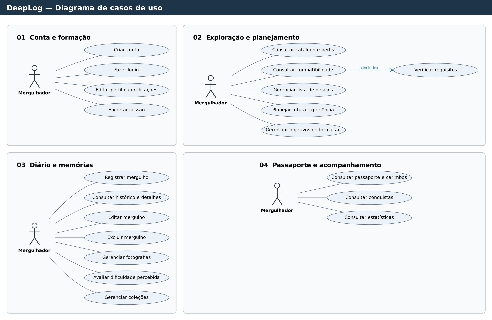
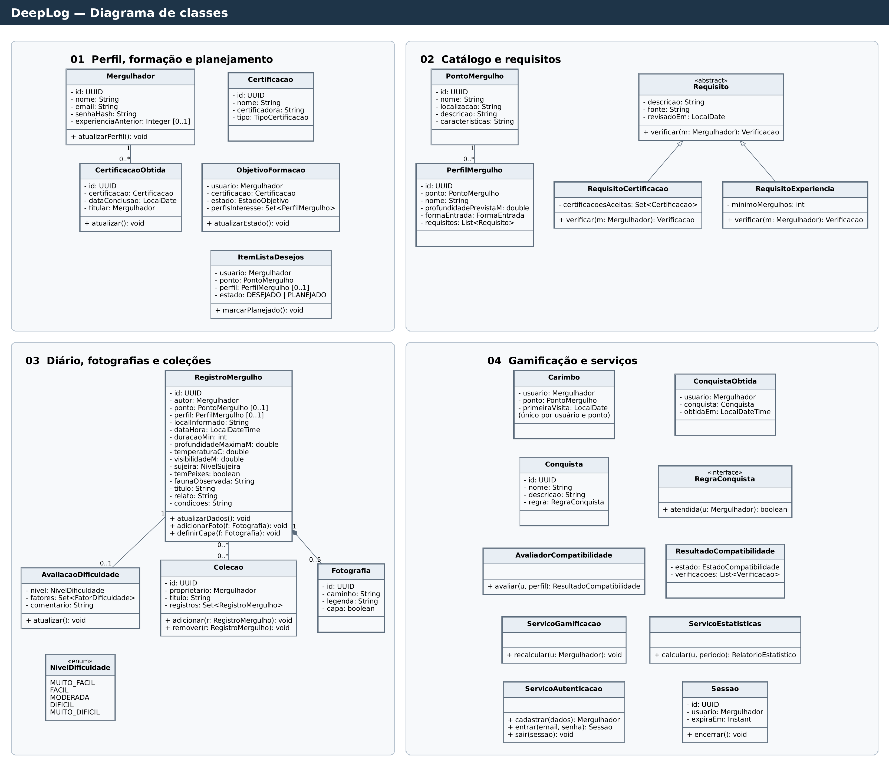

# DeepLog

Passaporte digital de aventuras subaquáticas. O projeto organiza registros de mergulho, fotografias, certificações e destinos de interesse.

## etapa 1 — ideia

Escolha do tema, definição do que o sistema faz e diagrama de casos de uso.



## etapa 2 — diagrama de classes

Diagrama UML com as classes do sistema. A ligação com o código está em [MODELAGEM.md](MODELAGEM.md).



## etapa 3 — implementação parcial

Implementação em Java das classes do diagrama da etapa 2, com encapsulamento, construtores, herança e polimorfismo.

- Cadastro, login e logout, com verificação de senha e sessão com expiração;
- Pontos e perfis de mergulho, certificações e verificação de requisitos;
- Registros de mergulho, avaliação de dificuldade, fotografias e coleções;
- Objetivos de formação e lista de desejos;
- Carimbos, conquistas e estatísticas do histórico.

Os dados ficam em memória. Esta entrega não inclui interface web nem banco de dados.

## etapa 4 — persistência, exceções e testes

Evolução da aplicação incorporando robustez, tratamento de falhas e automação:

- **Tratamento de Exceções Personalizadas:** Classes específicas (`ValidacaoException`, `AutenticacaoException`, `PersistenciaException`) com mensagens úteis.
- **Uso Adequado de Coleções:** Aplicação correta de `List`, `Set` e `Map` (`EnumMap`) nas estruturas de dados e regras de negócio.
- **Persistência em Arquivo (I/O):** Leitura e escrita do histórico de mergulhos utilizando os recursos de `java.nio.file` (`RepositorioArquivo`).
- **Testes Unitários:** Validação automatizada utilizando **JUnit 5** (`AutenticacaoTest` e `ModelagemTest`).
- **Código Limpo:** Estrutura organizada por domínio e livre de duplicações.

## etapa 5 — padrões de projeto

Foram aplicados dois padrões GoF no sistema.

### Strategy (pacote `gamificacao`)

**Problema:** as regras das conquistas estavam escritas como lambdas dentro do construtor do `ServicoGamificacao`. Para criar ou mudar uma regra era preciso mexer no serviço, e o código ficava difícil de ler.

**Solução:** a interface `RegraConquista` é a estratégia, com o método `atendida(Mergulhador)`. Cada regra virou uma classe:

- `RegraPrimeiroRegistro`: o mergulhador tem pelo menos um registro;
- `RegraPrimeiraFoto`: tem um registro com foto;
- `RegraPrimeiraColecao`: tem uma coleção com registros;
- `RegraMergulhoProfundo`: passou de uma profundidade mínima (nova regra, 20 metros).

Cada `Conquista` recebe a sua regra, e o `ServicoGamificacao` só chama `getRegra().atendida(usuario)`, sem saber como cada regra funciona.

**Por que é adequado:** as conquistas mudam com frequência. Com o Strategy, uma regra nova é só uma classe nova que implementa `RegraConquista`, sem alterar a lógica do serviço. Foi assim que a conquista "Mergulho profundo" foi adicionada.

### Template Method (pacote `requisitos`)

**Problema:** `RequisitoExperiencia` e `RequisitoCertificacao` repetiam a mesma verificação no início do método `verificar` (se o mergulhador era nulo, o resultado era `INDETERMINADO`).

**Solução:** a classe abstrata `Requisito` agora tem o método `verificar` como método template (`final`). Ele confere os dados básicos (`dadosBasicosValidos`) e depois chama o método abstrato `executarVerificacaoEspecifica`, que cada subclasse implementa com a sua regra específica.

**Por que é adequado:** todos os requisitos seguem os mesmos passos e só mudam na verificação final. O Template Method tira a repetição e garante que nenhum requisito esqueça a verificação comum. Um requisito novo só precisa implementar `executarVerificacaoEspecifica`.

As classes e métodos públicos têm Javadoc. O `PadroesTest` testa os dois padrões, e o `Main` mostra as conquistas liberadas pelas regras.

## organização

- `model`: classes do domínio;
- `requisitos`: verificações e resultado de compatibilidade;
- `autenticacao`: cadastro, senha e sessão;
- `gamificacao`: carimbos e regras de conquista;
- `servicos`: estatísticas;
- `persistencia`: leitura e escrita em arquivo (`RepositorioArquivo`);
- `excecoes`: exceções personalizadas do sistema;
- `enums`: tipos e estados;
- `src/test/java`: testes unitários com JUnit 5 (`AutenticacaoTest`, `ModelagemTest`, `PadroesTest`).

A relação entre o diagrama e o código está em [MODELAGEM.md](MODELAGEM.md).

## como executar

O projeto utiliza o **Maven** e requer o JDK 21 instalado. Na pasta raiz do projeto, utilize os comandos abaixo:

**Compilar o projeto:**
```bash
mvn clean compile
```

**Depois de compilar, copie e cole isso para executar:**
```bash
mvn exec:java -Dexec.mainClass="br.com.deeplog.Main"
```

O `Main` permite a entrada interativa de dados pelo usuário (cadastro, configuração de ponto e registro de mergulho), demonstrando compatibilidade, coleções, conquistas, estatísticas, persistência em arquivo (`registros_mergulho.txt`) e logout.

## testes

Para executar a suíte completa de testes unitários automatizados com JUnit 5:

```bash
mvn test
```
